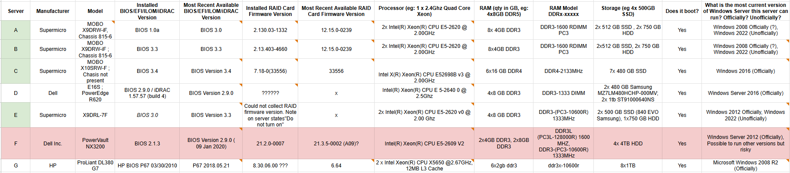

# Setting up our Hardware

Before working on a server, we needed to asset all of the specs of all of seven servers before being able to choose one.

<figure><figcaption></figcaption></figure>

We ended up with Server C which included:

* Supermicro MOBO X10SRW-F&#x20;
* BIOS 3.4 BIOS Version 3.4 7.18-0(33556)&#x20;
* Intel X(R) Xeon(R) CPU E52698B v3 @ 2.00GHz&#x20;
* 6x16 GB DDR4 DDR4-2133MHz&#x20;
* 7x 480 GB SSD&#x20;

This was done by loading up the server/opening up the chassis of the server, and mostly looking through its BIOS settings.

Using this server, we then checked the systems if they needed any updates, including BIOS, RAID BIOS, Bed Sector, SSD Firmware, and Ram Check.&#x20;

Luckily, most of our setting were already up to date, and it was a matter of just installing and running tests. For example, to check our RAM, we ran a test called "memtest86" through a USB stick, which we then booted into through the boot menu.

Another example would be loading up the RAID BIOS, and actually installing RAID Volumes. To load on to the RAID BIOS screen, we would just spam CTRL+A when the server was loading up.&#x20;

We can see here, that our RAID BIOS were version 7.18, which was the updated version for this type of server. After, we loaded into Local Device Configuration, to actually create and set up the volumes.

We also done a check on our SSDs, checking if there were any "bad sectors".


Bad sectors are parts of a storage device that can no longer reliably read or write data. They may result from physical damage or logical errors, and data stored there can be lost or corrupted; drives typically mark them unusable and avoid them


This was done in a little awkward way. We loaded up a bootable Windows 10 through a USB, connected it to the internet through a WiFi adapter, and downloaded a tool called "HD Tune Pro", which could perform automatic checks for us. &#x20;

After setting up the server and checking most of it, we would then need to install a hypervisor on it.&#x20;


### What is a hypervisor&#x20;

A hypervisor (also called a virtual machine monitor, or VMM) is software, firmware, or hardware that lets one computer run multiple virtual machines (VMs) at the same time. It pools computing resources (like processing and memory) from the host and assigns them to the guest operating systems, managing how the VMs share the hardware\
\
.png>)


For this lab, we chose Proxmox. Installing it on our hypervisor was actually pretty easy, and it worked like booting any other OS system. We downloaded proxmox on a bootable USB, pressed F11, select Proxmox VE, and begin installing.

What I learned from this section was four things.

1. Getting Familiar with the Boot Screen / Using USB to load up specific software&#x20;
2. Understanding how RAID SSDs work&#x20;
3. Familiarity with the BIOS/RAID Menus&#x20;
4. Troubleshooting

